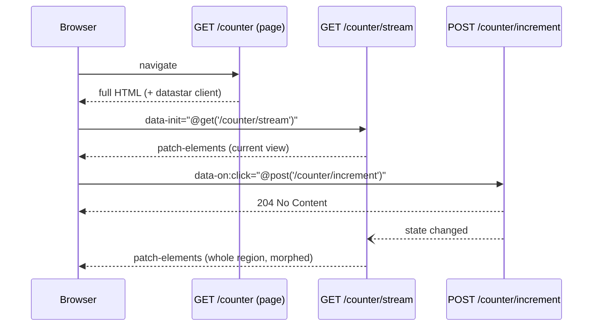

# SSE & Datastar

Gastro pairs naturally with [Datastar](https://data-star.dev/): the server
renders HTML, and Datastar keeps the page in sync over Server-Sent Events.
Two layers are available:

- **`github.com/andrioid/gastro/datastar`** — a separate Go module with
  Datastar support: a facade over the
  [official Go SDK](https://github.com/starfederation/datastar-go), plus the
  matching browser client, embedded and served by your app. It is released
  in lockstep with gastro (same version, tag `datastar/vX.Y.Z`), so its
  dependencies never reach projects that don't use it.
- **`gastro.NewSSE`** in core — a dependency-free, protocol-agnostic SSE
  writer for anything else (HTMX, plain `EventSource`). See
  [Generic SSE helper](#generic-sse-helper).

```sh
go get github.com/andrioid/gastro/datastar
```

## The shape: pages are queries, commands are handlers

Gastro follows the
[Tao of Datastar](https://data-star.dev/guide/the_tao_of_datastar), a CQRS
split:

- **A page is a query.** `GET /counter` renders the full HTML. The page
  opens **one long-lived SSE stream** (`GET /counter/stream`) that pushes the
  current view whenever state changes.
- **A command is a plain handler.** `POST /counter/increment` validates,
  writes, notifies, and answers **`204 No Content`**. It renders nothing.
- **Fat morphs.** The stream re-renders the whole page region and sends it
  as one `datastar-patch-elements` event. Datastar morphs it into the DOM,
  keeping focus, scroll position and input state, so the server never
  tracks which fragment changed.



Every tab watching the counter sees the change, not only the one that
clicked, and a command never needs to know which views exist.

[Live pages](#live-pages) automate the stream: one generic endpoint
re-renders whichever page is open.

## Wiring

```go
package main

import (
    "log"
    "net/http"

    "github.com/andrioid/gastro/datastar"

    gastro "myapp/.gastro"
    "myapp/app"
)

func main() {
    state := app.New()

    var router *gastro.Router
    router = gastro.New(
        gastro.WithDeps(state),
        // {{ datastarScript }} in templates.
        gastro.WithFuncs(datastar.Funcs()),
        // The embedded Datastar client at its content-hashed URL.
        gastro.WithHandler(datastar.ClientPattern, datastar.ClientHandler()),
        // Query side: one stream per page.
        gastro.WithHandler("GET /counter/stream", http.HandlerFunc(func(w http.ResponseWriter, r *http.Request) {
            counterStream(router, w, r)
        })),
        // Command side.
        gastro.WithHandler("POST /counter/increment", http.HandlerFunc(increment)),
    )

    log.Fatal(http.ListenAndServe(":4242", router.Handler()))
}
```

`WithHandler` routes share the router's middleware and deps, so
`gastroRuntime.FromContext[T](r.Context())` works in both handlers (the Go
spelling of frontmatter's `gastro.From[T]`).

The layout loads the client once:

```gastro
<head>
    <title>{{ .Title }}</title>
    {{ datastarScript }}
</head>
```

which renders
`<script type="module" src="/_gastro/datastar/<sha256-prefix>.js"></script>`.

## The page

`pages/counter.gastro` is a GET view. It renders the region the stream will
keep replacing (the `Counter` component, whose root is `<div id="counter">`)
and opens the stream from an element the stream never replaces:

```gastro
---
import (
    "myapp/app"

    Layout "components/layout.gastro"
    Counter "components/counter.gastro"
)

state := gastro.From[*app.State](r.Context())

Title := "Counter"
Count := state.Count()
---
{{ wrap Layout (dict "Title" .Title) }}
    <main data-init="@get('/counter/stream')">
        {{ Counter (dict "Count" .Count) }}
        <button data-on:click="@post('/counter/increment')">+1</button>
    </main>
{{ end }}
```

## The stream (query side)

```go
func counterStream(router *gastro.Router, w http.ResponseWriter, r *http.Request) {
    state := gastroRuntime.FromContext[*app.State](r.Context())

    sse, err := datastar.NewSSE(w, r, datastar.WithCompression())
    if err != nil {
        log.Printf("counter stream: %v", err)
        return
    }

    changes, unsubscribe := state.Subscribe()
    defer unsubscribe()

    for {
        // Always send the whole region: the first event resyncs a client
        // that just (re)connected, later ones are fat morphs.
        html, err := router.Render(gastro.Counter, gastro.CounterProps{Count: state.Count()})
        if err != nil {
            log.Printf("counter stream: render: %v", err)
            return
        }
        if err := sse.PatchElements(string(html)); err != nil {
            return // client went away
        }

        select {
        case <-sse.Context().Done():
            return
        case <-changes:
        }
    }
}
```

- The rendered fragment's top-level element carries an `id` (`counter`);
  Datastar morphs it into the element with the same id. In a real page the
  region is usually everything below the layout chrome.
- `sse.Context()` ends when the client disconnects; stop the loop then.
- Keep notifications coarse ("counter changed") and re-render from current
  state. Bursts of notifications can be coalesced; the next render shows
  the latest state anyway.

## Commands (write side)

```go
func increment(w http.ResponseWriter, r *http.Request) {
    var in struct {
        Step int `json:"step"`
    }
    if err := datastar.ReadSignals(r, &in); err != nil {
        http.Error(w, err.Error(), http.StatusBadRequest)
        return
    }

    state := gastroRuntime.FromContext[*app.State](r.Context())
    state.Increment(max(in.Step, 1)) // notifies subscribers

    w.WriteHeader(http.StatusNoContent)
}
```

`ReadSignals` decodes the signals Datastar sent: from the JSON body for
`POST`/`PUT`/`PATCH`, from the `datastar` query parameter for `GET` and
`DELETE`.

A command that needs to give the *acting* user immediate feedback (a
validation message, clearing an input) may answer with a short SSE response
instead of `204` — open `datastar.NewSSE`, send a `PatchSignals` or
`PatchElements`, return. Shared state still flows through the stream.
Call `ReadSignals` **before** `NewSSE`: the stream takes over the response.

A command that reports a *failure* through a patch must still answer
`200 OK`: see [Client behaviour to know](#client-behaviour-to-know).

## Live pages

The hand-written stream above re-renders one component. **Live pages**
generalise it: one stream per open page re-renders the *whole page*
through its normal GET handler after every change and morphs the page's
live root. Pages stay plain GET views; nothing else is written per page.

```go
state := app.New() // state.Changes is a datastar.Notifier

live := &datastar.LivePages{
    Signal:      &state.Changes, // anything with Subscribe() (<-chan struct{}, func())
    Root:        "app",          // id of the live root
    Compression: true,
}
router := gastro.New(
    gastro.WithDeps(state),
    gastro.WithFuncs(datastar.Funcs()),
    gastro.WithHandler(datastar.ClientPattern, datastar.ClientHandler()),
    gastro.WithFuncs(live.Funcs()),                    // {{ liveRoot }}, {{ liveScript }}
    gastro.WithHandler(live.Pattern(), live.Handler()), // GET /_gastro/live?path=…
    gastro.WithHandler("POST /counter/increment", http.HandlerFunc(increment)),
)
h := router.Handler()
live.Pages = h // the stream renders pages through the router itself
log.Fatal(http.ListenAndServe(":4242", h))
```

`Pages` is set after `New` because the router's handler only exists then;
set it before serving. The layout wraps the page in the live root and
starts the stream **outside** it, so a morph never restarts the stream:

```gastro
<body>
    {{ liveRoot .Children }}
    {{ liveScript }}
</body>
```

`liveRoot` renders `<div id="app">…</div>` (between two marker comments the
stream looks for); `liveScript` renders a hidden element whose
`data-init` opens
`GET /_gastro/live?path=<location.pathname + location.search>`. Commands
write, call `state.Changes.Notify()`, and answer `204`.

What the stream does:

- **Validates `path`**: it must be a same-origin absolute path
  (`/board?filter=open`) and not the stream itself; anything else is
  `400 Bad Request`.
- **Renders on connect and after every signal** as an internal `GET` of
  `path` through `Pages`, with the caller's `Cookie`, `Authorization` and
  `Accept-Language` headers, its `Host`, and `Gastro-Live-Fragment: <root>`.
  The internal request runs through the router's middleware again; it does
  not carry context values from outside the router.
- **Cuts out the live root** and sends it as one `datastar-patch-elements`
  event; Datastar morphs it into the element with the root's id. The rest of
  the page (head, chrome, `liveScript`) is never sent.
- **Keeps the last good DOM**: a render that does not answer `200`, panics,
  or has no live root is logged (`ErrorLog`, default `log.Default()`) and
  sends nothing. The next signal tries again.
- **Shares renders.** Streams with the same page URL, `Host` and forwarded
  headers (the render's only inputs) share one render per change: ten tabs
  of one user on one board cost one render, not ten. Different cookies
  render separately. Each stream still compresses its own copy, so the
  compressor's window spans that stream's earlier patches.
- **Compresses** with Brotli (or zstd, gzip, deflate) when `Compression` is
  set and the client accepts it.
- **Stops** rendering a page when its last stream disconnects, and
  unsubscribes from the signal.

Set `Debounce` (e.g. `100 * time.Millisecond`) to wait that long after a
signal before rendering, so a burst of changes costs one render.

`datastar.Notifier` is a ready-made signal: `Notify()` wakes every
subscriber without blocking, a burst leaves at most one pending signal per
subscriber, and cancelling a subscription never closes its channel. The
zero value is ready to use. It is protocol-neutral; use it for your own
streams too.

**Skipping work in fragment renders.** The stream cuts the root out of the
full page, so pages and layouts need no special mode. To skip expensive work
outside the root, check `datastar.IsFragment(r)` in frontmatter, or expose
it to layouts with
`WithRequestFuncs(func(r *http.Request) template.FuncMap { return template.FuncMap{"liveFragment": func() bool { return datastar.IsFragment(r) }} })`.
Any client can send the header, so use it to skip rendering, never for
access decisions.

**Cost.** Every change re-renders every distinct (page, identity) pair that
has an open stream. git-pm's prototype measured a 10k-event board at
~211 ms and 13.9 MB of HTML per render, 261 KB on the wire with Brotli
(66× smaller than identity). Keep live roots to what changes, use
`Debounce` for bursty writers, and keep notifications coarse.

[`examples/sse`](https://github.com/andrioid/gastro/tree/main/examples/sse)
is a complete live page.

## Client behaviour to know

Two behaviours of the embedded Datastar client (1.0.4) that surprise
server-side code:

- **Patches apply only on `200`.** The client applies the SSE (or HTML)
  body of a fetch response only when the status is exactly `200`; any other
  status, `4xx`/`5xx` included, drops the body. A command that reports a
  failure *through a patch* (an error banner, a field message) must answer
  `200` and carry the failure on the element itself (e.g.
  `<div id="error" data-status="409">…</div>`). A command with nothing to
  show answers `204` as usual.
- **`data-ignore-morph` must be on both sides.** The morph skips an element
  only when the old (in the DOM) *and* the new (in the patch) element both
  carry `data-ignore-morph`. It cannot be toggled client-side to protect an
  element being edited; render it from the server (e.g. on an editor while
  it is open) so every patch carries it too.

## Compression

Long-lived streams that repeatedly send the full region compress
extremely well, because the compressor's window spans events. Enable it per
stream:

```go
sse, err := datastar.NewSSE(w, r, datastar.WithCompression())
```

The encoding is negotiated from `Accept-Encoding` (Brotli, zstd, gzip,
deflate, in that order by default) and the compressor is flushed after
every event, so nothing is delayed. Pick encodings or levels explicitly
with `datastar.WithCompression(datastar.WithBrotli(datastar.WithBrotliLevel(5)), datastar.WithGzip())`,
and the negotiation strategy with `WithClientPriority()` or `WithForced()`.

Generic gzip middleware must still skip `text/event-stream`; see
[compression.md](compression.md).

## API

| Method / function | Event |
|---|---|
| `datastar.NewSSE(w, r, opts...) (*SSE, error)` | sets headers and flushes; returns an error (instead of the SDK's panic) when the writer cannot flush |
| `sse.PatchElements(html, opts...)` | `datastar-patch-elements`; options `WithSelector`, `WithMode` (`ModeOuter` default, `ModeInner`, `ModeReplace`, `ModePrepend`, `ModeAppend`, `ModeBefore`, `ModeAfter`, `ModeRemove`), `WithNamespace` (`NamespaceSVG`, `NamespaceMathML`), `WithUseViewTransitions`, `WithViewTransitionSelector` |
| `sse.RemoveElement(selector)` | patch-elements with mode `remove` |
| `sse.PatchSignals(json, opts...)` | `datastar-patch-signals` (JSON merge patch; `null` removes a signal); option `WithOnlyIfMissing` |
| `sse.MarshalAndPatchSignals(v, opts...)` | JSON-encodes `v`, then `PatchSignals` |
| `sse.ExecuteScript(js, opts...)` | appends a self-removing `<script>`; options `WithAutoRemove`, `WithAttributes` |
| `sse.Redirect(url)`, `sse.ConsoleLog(msg)` | script helpers |
| `sse.DispatchCustomEvent(name, detail, opts...)` | dispatches a `CustomEvent`; options `WithDispatchSelector`, `WithDispatchBubbles`, `WithDispatchCancelable`, `WithDispatchComposed` |
| `sse.Send(eventType, dataLines, opts...)` | raw event, same signature as the SDK; options `WithEventID`, `WithRetryDuration` |
| `sse.Context()`, `sse.IsClosed()` | stream lifetime |
| `datastar.ReadSignals(r, &v)` | decode request signals |
| `datastar.LivePages{Pages, Signal, Root, Path, Compression, Debounce, ErrorLog}` | [live pages](#live-pages): `Pattern()`, `Handler()`, `Funcs()` (`liveRoot`, `liveScript`) |
| `datastar.IsFragment(r)` | the request is a live-page re-render |
| `datastar.Notifier` | coalescing change signal: `Subscribe()`, `Notify()`, `Subscribers()` |

The wire format is the SDK's own. Every method is safe for concurrent use.
User-controlled strings cannot inject SSE fields: values that must stay on
one line (selectors, modes, ids, event types) lose CR and LF, and CRLF/CR in
multi-line payloads (HTML, scripts, signals) is normalised to LF before it
is split into `data:` lines.

## The embedded client

The module embeds the official Datastar bundle (`datastar.ClientVersion`,
MIT-licensed, `datastar/client/LICENSE.md`) that speaks the SDK's protocol
version. `datastar.ClientPath` contains a prefix of its SHA-256, so the URL
changes exactly when the client does; `ClientHandler()` serves it with
`Cache-Control: public, max-age=31536000, immutable` and an `ETag`. Upgrading
gastro upgrades the client and busts caches; no CDN or vendored copy is
needed.

## Generic SSE helper

The core helper in `pkg/gastro` is framework-agnostic and adds no
dependencies:

```go
func handleUpdates(w http.ResponseWriter, r *http.Request) {
    sse := gastroRuntime.NewSSE(w, r)

    ticker := time.NewTicker(1 * time.Second)
    defer ticker.Stop()

    for {
        select {
        case <-sse.Context().Done():
            return
        case <-ticker.C:
            if err := sse.Send("time", time.Now().Format("15:04:05")); err != nil {
                return
            }
        }
    }
}
```

- **`Send(eventType, data ...string)`** — writes and flushes one event; each
  argument becomes a `data:` line (CR is stripped).
- **`IsClosed()`** — reports whether the client disconnected.
- **`Context()`** — the request context, for `select` loops.

Request-aware template helpers (CSRF tokens, i18n, CSP nonces) inside
rendered patches are covered in [helpers.md](helpers.md).

[Try the live Datastar demo →](/examples/guestbook-datastar)
